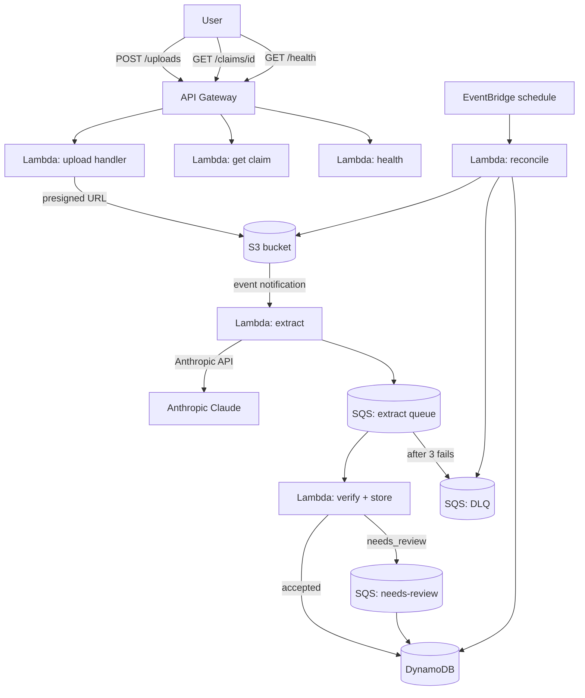

# claim-intake

Serverless insurance claim ingestion and AI extraction pipeline, built entirely on
LocalStack as a hands-on AWS serverless learning project.

A user uploads a claim document → an AI extracts structured fields → code verifies
the AI's output → valid records are stored in DynamoDB.

```
POST /uploads  →  presigned S3 URL
                        │
               S3 event notification
                        ↓
              Lambda: extract  (Python 3.12)
              Calls Anthropic API → structured JSON
                        │
                      SQS
                        ↓
              Lambda: verify + store
              Checks fields, sums, dates
                        │
              ┌─────────┴──────────┐
           accepted            needs_review
          DynamoDB              DynamoDB + SQS
                        │
              EventBridge (schedule)
                        ↓
              Lambda: reconcile
              Reports gaps + DLQ depth
```

**All infrastructure is defined in `template.yaml` (AWS SAM).  
No real AWS account is used.**

---

## Architecture diagram



---

## Running locally

### Prerequisites

- Docker
- [AWS SAM CLI](https://docs.aws.amazon.com/serverless-application-model/latest/developerguide/install-sam-cli.html)
- `pip install aws-sam-cli-local awscli-local`
- LocalStack running in K3s (or locally): `kubectl port-forward -n localstack svc/localstack 4566:4566`

### Configure dummy credentials

LocalStack accepts any non-empty credentials:

```bash
aws configure set aws_access_key_id test
aws configure set aws_secret_access_key test
aws configure set region us-east-1
```

### Deploy

```bash
samlocal build
samlocal deploy \
  --stack-name claim-intake \
  --resolve-s3 \
  --no-confirm-changeset \
  --parameter-overrides AnthropicApiKey=<key> UseRealAI=false
```

### Get the API URL

```bash
awslocal cloudformation describe-stacks \
  --stack-name claim-intake \
  --query 'Stacks[0].Outputs[?OutputKey==`ApiUrl`].OutputValue' \
  --output text
```

### Hit the health endpoint

```bash
curl <API_URL>/health
# {"status": "ok", "service": "claim-intake"}
```

### Real-AI mode (demo)

Pass `UseRealAI=true` and a real `AnthropicApiKey` as parameter overrides. A daily
call cap is enforced by the reconcile Lambda (see `template.yaml` for the limit).

---

## Running tests

```bash
pip install -e ".[dev]"
pytest tests/unit -v
pytest tests/e2e -v   # requires LocalStack running + API_URL set
```

---

## CI

Every PR runs:
1. **AI gate** — gitleaks + kube-linter + Claude diff review
2. **SAM CI** — spins up throwaway LocalStack, `samlocal deploy`, smoke test, unit + e2e tests

Anthropic calls are mocked in CI (`USE_MOCK_AI=true`). CI is free and repeatable.

On merge to main: builds `Dockerfile.deploy` → pushes to GHCR → ArgoCD PostSync
Job deploys the stack to the persistent LocalStack in the K3s cluster (PR 5).

---

## Design decisions

**Why SQS between extract and verify?**  
Decoupling. The extract Lambda can finish and return before verify runs. If verify
fails (or the service is under load), the message stays in SQS and is retried
automatically. Without the queue, a verify crash loses the extracted data.

**Why is verification code, not another AI call?**  
Determinism. Business rules (amounts sum to total, date isn't in the future) have
exact answers. An AI call adds latency, cost, and nondeterminism to a check that
a few lines of Python can answer with certainty. Reserve AI for tasks where the
answer isn't computable.

**How idempotency works (and why it matters in interviews)**  
See [LEARNING.md](LEARNING.md) — PR 3 section.

**How the DLQ protects the pipeline**  
See [LEARNING.md](LEARNING.md) — PR 4 section.

---

## Repository structure

```
claim-intake/
├── template.yaml          # AWS SAM — single source of truth for all infra
├── lambdas/
│   ├── health/            # GET /health
│   ├── extract/           # S3 trigger → Anthropic → SQS  (PR 2)
│   ├── verify/            # SQS → DynamoDB                (PR 3)
│   └── reconcile/         # EventBridge schedule          (PR 4)
├── tests/
│   ├── unit/              # pytest: verify rules, idempotency, parsing
│   └── e2e/               # pytest: full upload → assert final state
├── sample_data/           # synthetic claim docs           (PR 6)
├── Dockerfile.deploy      # samlocal deploy image          (PR 5)
├── LEARNING.md            # running serverless explainer
└── README.md
```
